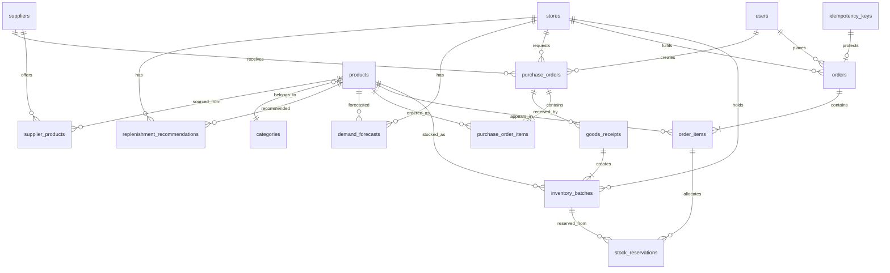

# SmartGrocery ERD and Database Schema

This document is the backend contract for PostgreSQL.
It implements the entities listed in `docs/architecture/system-architecture.md`.
Do not change table names, required columns, or status enums without a group review.

## 1. Roles of the schema

- Support B2C catalog, cart checkout, and order history.
- Track inventory by lot/batch with FEFO allocation.
- Reserve stock atomically during checkout.
- Support suppliers, purchase orders, and goods receiving.
- Store forecasts and replenishment recommendations produced by the intelligence service.

## 2. Entity-relationship diagram

## 3. Enums

| Enum | Values |
|---|---|
| `user_role` | `customer`, `merchant`, `admin` |
| `order_status` | `pending`, `confirmed`, `cancelled`, `fulfilled` |
| `batch_status` | `available`, `depleted`, `expired`, `quarantined` |
| `purchase_order_status` | `draft`, `pending_approval`, `approved`, `sent`, `partially_received`, `received`, `cancelled` |
| `recommendation_status` | `pending`, `approved`, `rejected`, `converted` |
| `job_status` | `queued`, `running`, `succeeded`, `failed` |

`confirmed` means payment/checkout succeeded and stock is reserved.
`fulfilled` means the order left the warehouse (MVP may set this immediately after confirm if there is no separate picking step).

## 4. Tables

### 4.1 `users`

| Column | Type | Notes |
|---|---|---|
| id | UUID PK | |
| email | CITEXT UNIQUE NOT NULL | login identity |
| password_hash | TEXT NOT NULL | never store plain passwords |
| full_name | TEXT NOT NULL | |
| role | user_role NOT NULL | default `customer` |
| is_active | BOOLEAN NOT NULL DEFAULT TRUE | |
| created_at | TIMESTAMPTZ NOT NULL | |
| updated_at | TIMESTAMPTZ NOT NULL | |

### 4.2 `stores`

MVP may seed a single store. Multi-store keys stay in the schema.

| Column | Type | Notes |
|---|---|---|
| id | UUID PK | |
| code | TEXT UNIQUE NOT NULL | e.g. `SG-HCM-01` |
| name | TEXT NOT NULL | |
| address | TEXT | |
| timezone | TEXT NOT NULL DEFAULT `Asia/Ho_Chi_Minh` | |
| is_active | BOOLEAN NOT NULL DEFAULT TRUE | |

### 4.3 `categories`

| Column | Type | Notes |
|---|---|---|
| id | UUID PK | |
| slug | TEXT UNIQUE NOT NULL | |
| name | TEXT NOT NULL | |
| image_url | TEXT | |

### 4.4 `products`

| Column | Type | Notes |
|---|---|---|
| id | UUID PK | |
| sku | TEXT UNIQUE NOT NULL | |
| name | TEXT NOT NULL | |
| description | TEXT | |
| category_id | UUID FK categories | |
| unit | TEXT NOT NULL | `kg`, `pack`, `piece` |
| selling_price | NUMERIC(12,2) NOT NULL | storefront price |
| is_perishable | BOOLEAN NOT NULL DEFAULT TRUE | |
| default_shelf_life_days | INTEGER | used when receiving if expiry omitted |
| image_url | TEXT | |
| is_active | BOOLEAN NOT NULL DEFAULT TRUE | inactive products are hidden from catalog |

### 4.5 `inventory_batches`

Physical stock. Sellable quantity = `quantity_on_hand - quantity_reserved`.

| Column | Type | Notes |
|---|---|---|
| id | UUID PK | |
| store_id | UUID FK stores NOT NULL | |
| product_id | UUID FK products NOT NULL | |
| lot_code | TEXT NOT NULL | |
| quantity_on_hand | NUMERIC(12,3) NOT NULL | |
| quantity_reserved | NUMERIC(12,3) NOT NULL DEFAULT 0 | |
| received_at | TIMESTAMPTZ NOT NULL | |
| expiry_date | DATE | required when product is perishable |
| unit_cost | NUMERIC(12,2) | |
| status | batch_status NOT NULL DEFAULT `available` | |
| goods_receipt_id | UUID FK goods_receipts | nullable for seed stock |

Unique: `(store_id, product_id, lot_code)`.

Check: `quantity_on_hand >= quantity_reserved` and both `>= 0`.

### 4.6 `orders`

| Column | Type | Notes |
|---|---|---|
| id | UUID PK | |
| store_id | UUID FK stores NOT NULL | |
| customer_id | UUID FK users NOT NULL | |
| status | order_status NOT NULL | |
| subtotal | NUMERIC(12,2) NOT NULL | |
| total | NUMERIC(12,2) NOT NULL | |
| currency | TEXT NOT NULL DEFAULT `VND` | |
| idempotency_key | TEXT UNIQUE | required for checkout |
| cancelled_reason | TEXT | |
| created_at | TIMESTAMPTZ NOT NULL | |
| updated_at | TIMESTAMPTZ NOT NULL | |

### 4.7 `order_items`

| Column | Type | Notes |
|---|---|---|
| id | UUID PK | |
| order_id | UUID FK orders NOT NULL | |
| product_id | UUID FK products NOT NULL | |
| quantity | NUMERIC(12,3) NOT NULL | |
| unit_price | NUMERIC(12,2) NOT NULL | snapshot of selling price |
| line_total | NUMERIC(12,2) NOT NULL | |

### 4.8 `stock_reservations`

Created inside the checkout transaction. FEFO picks the earliest `expiry_date`, then earliest `received_at`.

| Column | Type | Notes |
|---|---|---|
| id | UUID PK | |
| order_item_id | UUID FK order_items NOT NULL | |
| batch_id | UUID FK inventory_batches NOT NULL | |
| quantity | NUMERIC(12,3) NOT NULL | |

### 4.9 `idempotency_keys`

| Column | Type | Notes |
|---|---|---|
| key | TEXT PK | client header `Idempotency-Key` |
| user_id | UUID FK users NOT NULL | |
| request_hash | TEXT NOT NULL | |
| response_code | INTEGER | |
| response_body | JSONB | |
| created_at | TIMESTAMPTZ NOT NULL | |
| expires_at | TIMESTAMPTZ NOT NULL | |

### 4.10 `suppliers`

| Column | Type | Notes |
|---|---|---|
| id | UUID PK | |
| name | TEXT NOT NULL | |
| contact_email | TEXT | |
| contact_phone | TEXT | |
| lead_time_days | INTEGER NOT NULL DEFAULT 2 | |
| is_active | BOOLEAN NOT NULL DEFAULT TRUE | |

### 4.11 `supplier_products`

| Column | Type | Notes |
|---|---|---|
| supplier_id | UUID FK | |
| product_id | UUID FK | |
| supplier_sku | TEXT | |
| unit_cost | NUMERIC(12,2) NOT NULL | |
| min_order_qty | NUMERIC(12,3) NOT NULL DEFAULT 1 | |

PK: `(supplier_id, product_id)`.

### 4.12 `purchase_orders`

| Column | Type | Notes |
|---|---|---|
| id | UUID PK | |
| store_id | UUID FK NOT NULL | |
| supplier_id | UUID FK NOT NULL | |
| status | purchase_order_status NOT NULL | |
| created_by | UUID FK users NOT NULL | |
| approved_by | UUID FK users | |
| notes | TEXT | |
| created_at | TIMESTAMPTZ NOT NULL | |
| updated_at | TIMESTAMPTZ NOT NULL | |

### 4.13 `purchase_order_items`

| Column | Type | Notes |
|---|---|---|
| id | UUID PK | |
| purchase_order_id | UUID FK NOT NULL | |
| product_id | UUID FK NOT NULL | |
| quantity_ordered | NUMERIC(12,3) NOT NULL | |
| quantity_received | NUMERIC(12,3) NOT NULL DEFAULT 0 | |
| unit_cost | NUMERIC(12,2) NOT NULL | |

### 4.14 `goods_receipts`

| Column | Type | Notes |
|---|---|---|
| id | UUID PK | |
| purchase_order_id | UUID FK NOT NULL | |
| received_by | UUID FK users NOT NULL | |
| received_at | TIMESTAMPTZ NOT NULL | |

Receiving a PO creates one or more `inventory_batches` and increments `quantity_received`.

### 4.15 `demand_forecasts`

Written by the intelligence service through backend APIs/jobs. Grain: store–SKU–day.

| Column | Type | Notes |
|---|---|---|
| id | UUID PK | |
| store_id | UUID FK NOT NULL | |
| product_id | UUID FK NOT NULL | |
| target_date | DATE NOT NULL | calendar day being forecast |
| predicted_qty | NUMERIC(12,3) NOT NULL | |
| model_name | TEXT NOT NULL | `seasonal_naive` or `lightgbm` |
| model_version | TEXT NOT NULL | |
| generated_at | TIMESTAMPTZ NOT NULL | |
| job_id | UUID FK forecast_jobs | |

Unique: `(store_id, product_id, target_date, model_version)`.

### 4.16 `replenishment_recommendations`

| Column | Type | Notes |
|---|---|---|
| id | UUID PK | |
| store_id | UUID FK NOT NULL | |
| product_id | UUID FK NOT NULL | |
| suggested_qty | NUMERIC(12,3) NOT NULL | |
| safety_stock | NUMERIC(12,3) | |
| reorder_point | NUMERIC(12,3) | |
| meu_score | NUMERIC(12,6) | Maximum Expected Utility |
| reason | TEXT | human-readable rule/model explanation |
| status | recommendation_status NOT NULL DEFAULT `pending` | |
| source_job_id | UUID | |
| created_at | TIMESTAMPTZ NOT NULL | |
| decided_by | UUID FK users | |
| decided_at | TIMESTAMPTZ | |
| purchase_order_id | UUID FK | set when converted |

### 4.17 `forecast_jobs`

| Column | Type | Notes |
|---|---|---|
| id | UUID PK | |
| status | job_status NOT NULL | |
| triggered_by | TEXT NOT NULL | `schedule` or `manual` |
| started_at | TIMESTAMPTZ | |
| finished_at | TIMESTAMPTZ | |
| error_message | TEXT | |

### 4.18 `business_rules`

Rule engine configuration. Code is stable; parameters are JSON.

| Column | Type | Notes |
|---|---|---|
| id | UUID PK | |
| code | TEXT UNIQUE NOT NULL | e.g. `FEFO_ALLOCATION` |
| name | TEXT NOT NULL | |
| parameters | JSONB NOT NULL DEFAULT `{}` | |
| is_active | BOOLEAN NOT NULL DEFAULT TRUE | |

Seeded rules for MVP:

- `FEFO_ALLOCATION`
- `EXPIRY_WARNING`
- `LOW_STOCK_ALERT`
- `DO_NOT_SELL_EXPIRED`

## 5. Derived inventory view

`inventory_positions` is a SQL view, not a table:

- `on_hand` = sum of `quantity_on_hand` for available batches
- `reserved` = sum of `quantity_reserved`
- `available` = `on_hand - reserved`
- `nearest_expiry` = min `expiry_date` among available batches with remaining sellable qty

Storefront availability must use `available`, never `on_hand` alone.

## 6. Concurrency rules

- Checkout, reservation, and receiving run in a single database transaction.
- Batch rows are locked with `SELECT ... FOR UPDATE` during reservation.
- Checkout without `Idempotency-Key` is rejected.
- Replaying the same key with the same payload returns the original order.
- Replaying the same key with a different payload returns `409`.

## 7. Out of scope for this schema

No chatbot tables, computer-vision tables, reinforcement-learning tables, or genetic-algorithm tables.
